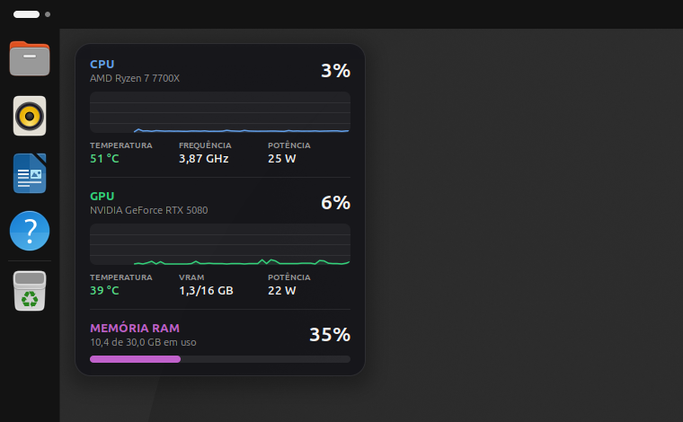
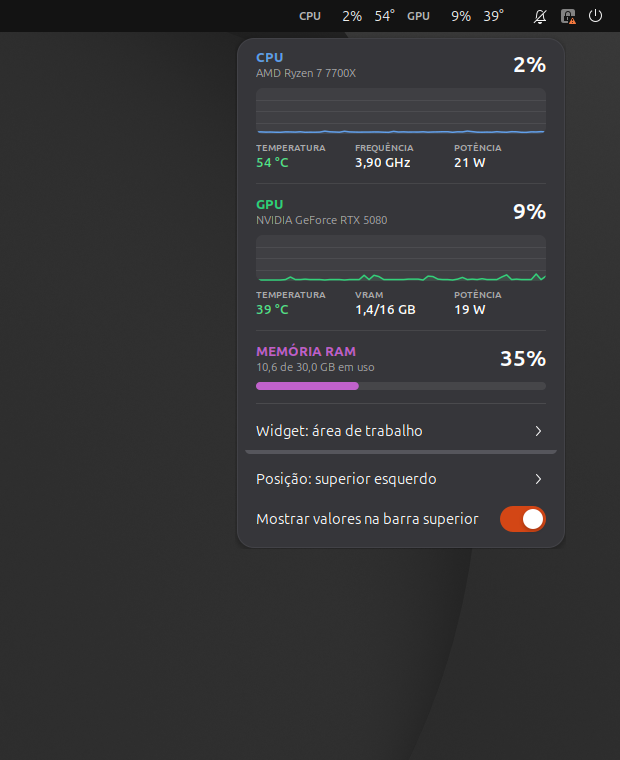

<h1 align="center">Kodō 鼓動</h1>

<p align="center">Monitor de CPU e GPU para GNOME</p>
<p align="center">Kodō 鼓動【こどう】(s.) batimento do coração, pulsação</p>

Extensão do GNOME Shell que mostra o pulso do seu PC: uso de **CPU**, **GPU (NVIDIA)**,
**memória RAM** e as **temperaturas** em um widget fixo na área de trabalho e em um indicador
na barra superior.

<p>
  
  
</p>

## Recursos

- **Widget na área de trabalho**, na mesma camada do papel de parede (fica atrás das janelas), com:
  - **CPU**: uso, gráfico dos últimos 2 minutos, temperatura, frequência média e potência do soquete
  - **GPU**: uso, gráfico, temperatura, VRAM usada/total e potência
  - **RAM**: uso com barra
- **Indicador na barra superior** sempre visível (`CPU 3% 51°  GPU 6% 39°`). Ao clicar, abre o
  painel completo e as opções.
- Temperaturas coloridas: verde, amarelo e vermelho conforme esquentam.
- Opções pelo menu da barra superior:
  - **Widget**: na área de trabalho, sempre visível sobre as janelas (some em tela cheia) ou oculto
  - **Posição**: qualquer um dos 4 cantos
  - **Valores na barra superior**: liga/desliga (desligado, fica só o ícone)
- Leve: atualiza a cada 2 s, lê os arquivos de forma assíncrona e usa um único processo
  `nvidia-smi` contínuo em vez de abrir um novo a cada leitura.

## Requisitos

- GNOME Shell 45 a 51, testado em todas essas versões (o Ubuntu 24.04 LTS vem com o GNOME 46 e o
  26.04 LTS com o 50). Não funciona no GNOME 44 ou anterior: o formato das extensões mudou no 45
  (ES modules).
- GPU NVIDIA com driver proprietário (`nvidia-smi`) para os dados da GPU.
- Sensores do kernel para a temperatura da CPU: `k10temp` (AMD), `zenpower` ou `coretemp` (Intel).

## Instalação

```bash
git clone <url-do-repositório> kodo-cgpu
cd kodo-cgpu
./install.sh
```

Não precisa de `sudo`. Depois, **saia e entre na sessão uma vez**: no Wayland o GNOME só
descobre extensões novas no login. Nos logins seguintes ela carrega sozinha.

### Carregar sem sair da sessão

Depois do `./install.sh`, pressione **Alt+F2**, digite `lg`, aperte **Enter** e cole na linha de
comando do Looking Glass:

```js
Main.extensionManager.loadExtension(Main.extensionManager.createExtensionObject('kodo-cgpu@desktop.local', Gio.File.new_for_path(GLib.get_home_dir() + '/.local/share/gnome-shell/extensions/kodo-cgpu@desktop.local'), 2))
```

Aperte **Enter** e depois **Esc** para fechar. Isso só funciona na primeira carga. Para aplicar
mudanças numa extensão já carregada, é preciso sair e entrar na sessão.

### Desinstalar

```bash
./install.sh --uninstall
```

## Desenvolvimento

```bash
./install.sh --link          # a pasta de extensões passa a apontar para src/
scripts/test-headless.sh     # testa num GNOME Shell isolado e gera capturas em test-output/
scripts/test-matrix.sh       # repete o teste do GNOME 45 ao 51, em containers Docker
journalctl --user -f -o cat /usr/bin/gnome-shell   # log do GNOME Shell da sessão
```

`scripts/test-headless.sh` sobe um GNOME Shell sem tela, com D-Bus, configurações e pastas
próprios, então não afeta a sessão atual e dispensa sair dela para testar. Ele tira capturas da
área de trabalho e do menu, usa os menus da extensão (modo, posição, valores na barra), desativa e
reativa a extensão (o GNOME faz isso ao bloquear a tela) e falha se algum passo não der o resultado
esperado, se a extensão não ficar ativa ou se aparecer erro dela no log.

`scripts/test-matrix.sh` roda esse mesmo teste em cada versão do GNOME Shell, do 45 ao 51, cada uma
num container com o Ubuntu que trouxe aquela versão (precisa de Docker). Dá para escolher as versões
(`scripts/test-matrix.sh 46 50`). Os resultados ficam em `test-output/gnome-<versão>/`. Na primeira
vez ele baixa as imagens, de cerca de 1 GB cada.

Como os módulos JavaScript ficam em cache no GNOME Shell, mudanças no código só valem na sessão
real depois de sair e entrar de novo. O script de teste não tem essa limitação.

### Estrutura

```
src/
  metadata.json      metadados (UUID, versões do GNOME suportadas)
  extension.js       coleta de dados, widget, indicador e menu
  stylesheet.css     aparência
  schemas/           configurações (modo, posição, valores na barra)
install.sh           instala / modo desenvolvimento / desinstala
scripts/
  test-headless.sh   teste automatizado em GNOME Shell isolado
  test-matrix.sh     o mesmo teste do GNOME 45 ao 51, em containers Docker
docs/                capturas de tela
```

### De onde vêm os dados

| Informação | Fonte |
|---|---|
| Uso da CPU | `/proc/stat` (diferença entre duas leituras) |
| Frequência da CPU | média de `cpu MHz` em `/proc/cpuinfo` |
| Temperatura da CPU | hwmon `k10temp` (Tctl/Tdie), `zenpower` ou `coretemp` |
| Potência da CPU | sensor `PPT` do `amdgpu` integrado (só AMD com vídeo integrado; mede o soquete inteiro) |
| GPU (uso, temperatura, VRAM, potência) | `nvidia-smi --query-gpu=... -lms 2000` (um processo contínuo) |
| RAM | `/proc/meminfo` (`MemTotal` − `MemAvailable`) |

### Configurações por linha de comando

As opções do menu também podem ser alteradas com `gsettings`:

```bash
SCHEMAS=~/.local/share/gnome-shell/extensions/kodo-cgpu@desktop.local/schemas
gsettings --schemadir $SCHEMAS set org.gnome.shell.extensions.kodo-cgpu widget-mode 'above'        # desktop | above | hidden
gsettings --schemadir $SCHEMAS set org.gnome.shell.extensions.kodo-cgpu widget-position 'top-right' # top-left | top-right | bottom-left | bottom-right
gsettings --schemadir $SCHEMAS set org.gnome.shell.extensions.kodo-cgpu show-panel-text false
```
